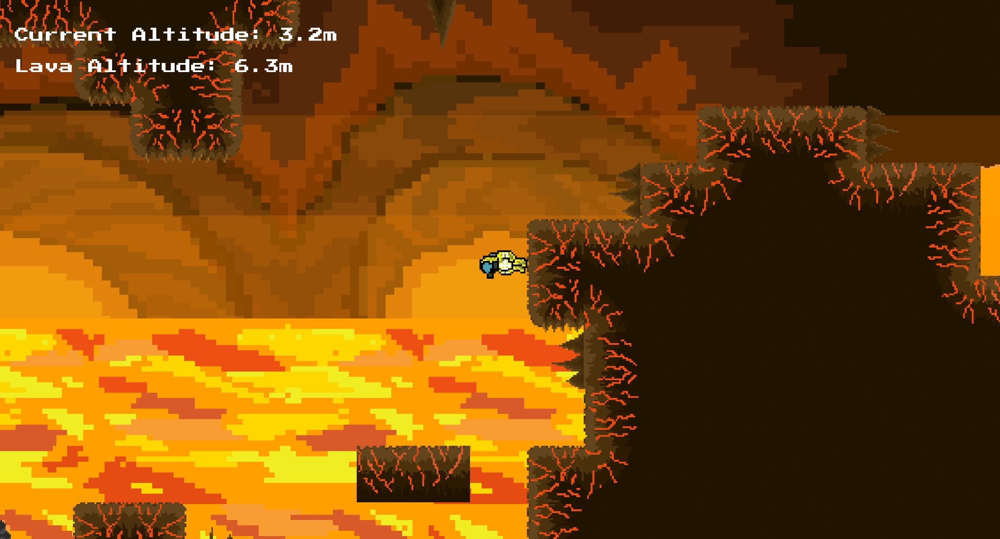
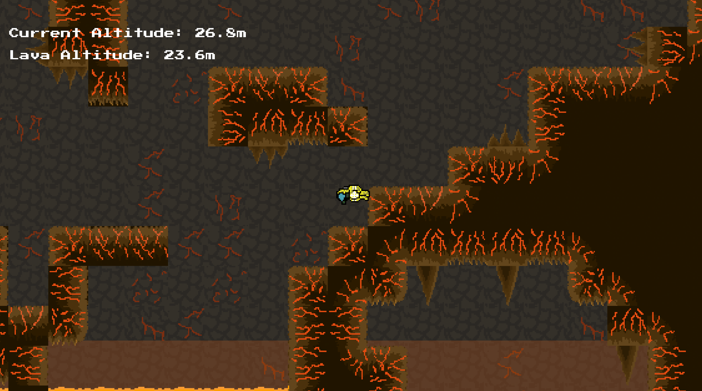
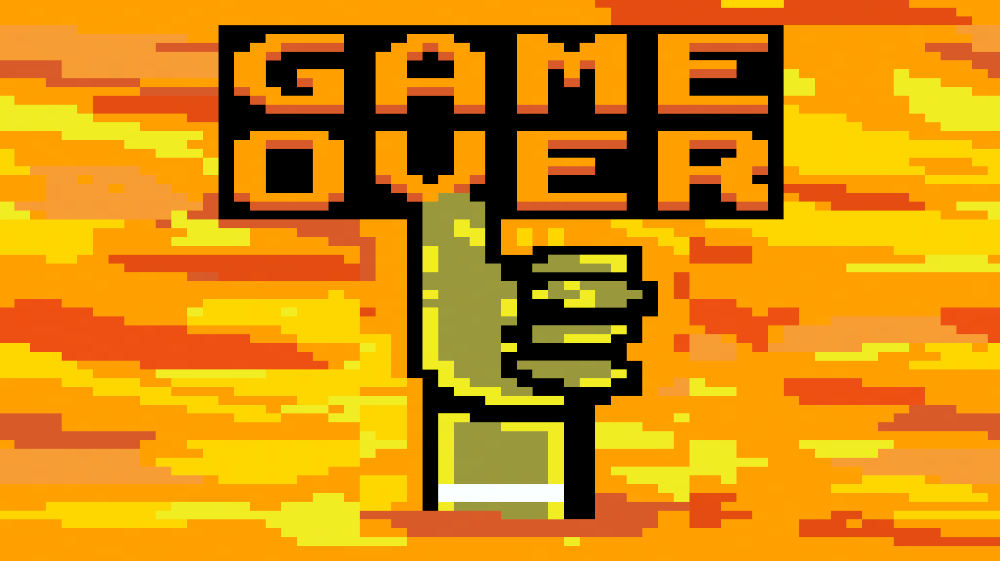

**A retro gravity-switching escape game. Fly up through the tunnels of an erupting volcano before the lava catches you.**

Built in Unity 6 in 24 hours for the CSS Game Jam (theme: *Retro*).

---

## Table of Contents

- [About the Game](#about-the-game)
- [Hazards](#hazards)
- [Screenshots](#screenshots)
- [Technical Overview](#technical-overview)
- [Challenges and Solutions](#challenges-and-solutions)
- [What I Learned](#what-i-learned)
- [Team](#team)
- [Running the Project](#running-the-project)
- [Credits](#credits)
- [Licence](#licence)

---

## About the Game

Volcano Escapist is a retro-styled 2D escape game. The volcano is erupting, the lava is rising, and the only way out is up. You navigate a small maze of tunnels to the summit by **changing which way gravity pulls**, using it to carry you through gaps that normal movement could never reach. There is no time to wander, because the rising lava kills on contact, so every route is a race.

A live readout in the corner shows your current altitude and the lava's altitude, so you can see at a glance how much of a lead you have.

The game was made as part of a 24-hour game jam hosted by the Computer Science Society (CSS) at the University of Bristol. The theme was *Retro*, which shaped the hand-drawn pixel-art look.

## Hazards

| Hazard | Effect |
| --- | --- |
| **Rising lava** | Climbs steadily up the volcano and kills on contact, so you are always on the clock |
| **Lava pools** | Scattered through the tunnels and kill on contact |
| **Static spikes** | Stun you for a moment, which resets gravity to normal |
| **Falling spikes** | Fall at random and have the same stun effect as static spikes, making the route less predictable |

Because a stun reverts gravity to normal, a single hit can wreck a carefully planned route, which turns every spike into a real threat.

## Screenshots

| | |
| --- | --- |
|  |
|   |
| |

## Technical Overview

| | |
| --- | --- |
| **Engine** | Unity 6 (2D) |
| **Platform** | Windows |
| **Art** | Hand-drawn pixel art in Piskel |
| **Level building** | Unity Tilemaps with tile placement rules |
| **Team** | 2 people |
| **Development time** | 24 hours |

## Challenges and Solutions

### 1. Tilemapping and tile rules

**Challenge.** The tunnels, walls and cave edges had to look right and be quick to build in a 24-hour window. Placing every tile by hand would have been slow, and tiles meeting at corners and edges had to line up correctly.

**Solution.** The level was built with Unity's tilemap tooling, with rules defining how tiles fit together, so the correct tile is chosen automatically depending on its neighbours. Most of the heavy lifting was handled by Unity, and this part of the project was built by my teammate Rowan.

### 2. Game architecture

**Challenge.** I was still refining my approach to structuring a Unity project, and a jam leaves no room to refactor. Gravity switching, stun states, rising lava and random spikes all needed to cooperate without turning the code into a tangle.

**Solution.** I split the behaviour into separate components for the player, hazards and level, and spent a good part of the jam debugging the interactions between them.

### 3. Working in Git without breaking the project

**Challenge.** Unity projects are notoriously easy to damage when two people work in the same repository. Scene files in particular merge badly, and earlier jams had left us with broken projects and conflicts.

**Solution.** This was the project where we finally got it right:

- A **proper `.gitignore`** for Unity, so generated folders and local settings never enter version control.
- **Exclusive scene ownership.** Only one person works in a scene at any one time, which avoids the merge conflicts that scene files cause.

That workflow has stayed with us on every project since.

## What I Learned

**A reliable Git workflow for Unity.** The most valuable outcome of this project was learning how to collaborate on a Unity project through Git without it breaking. Getting the `.gitignore` right and making scene work exclusive to one person removed a whole class of problems for every later project.

**Steady improvement.** Beyond that, I did not pick up one big new skill here. It was a project where I improved across the board: hand-drawing a complete set of pixel-art visuals in Piskel, debugging under time pressure, and building game systems quickly.

**Architecture takes practice.** I was still working out how I like to structure a Unity game, and a 24-hour deadline showed me the cost of an approach that is not yet settled. It pushed me to keep refining the way I organise a project.

## Team

Volcano Escapist was built by a team of two, under the name **TypeVoidGames**.

| Member | Contributions |
| --- | --- |
| **[Mateusz Golebiewski](https://github.com/MateuszGolebiewski591)** | Most of the visuals (hand-drawn in Piskel), debugging, various game systems |
| **[Rowan Watcham](https://github.com/RowanWatcham)** | Tilemapping and tile rules, sound sourcing |

## Running the Project

**Play the game:** download the Windows build from [itch.io](https://typevoidgames.itch.io/volcano-escapists).

**Open the project:**

1. Install a Unity 6 editor through Unity Hub.
2. Clone this repository: `git clone https://github.com/MateuszGolebiewski591/Volcano-Escapist`
3. Add the project in Unity Hub and open it.

## Credits

The pixel art was drawn by hand in [Piskel](https://www.piskelapp.com/). The game uses free sound assets with no attached licence, so no attribution is required.

## Licence

This project has no formal licence. It is open source for others to look at and learn from.
